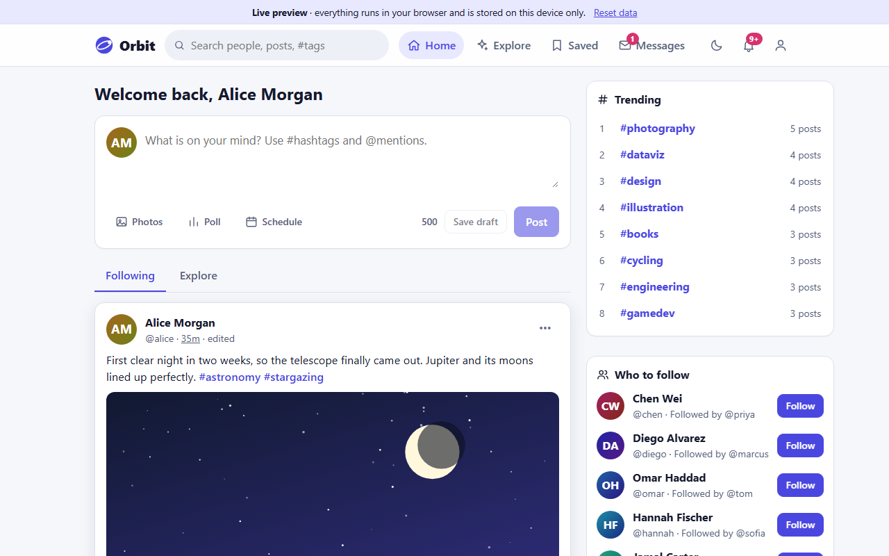
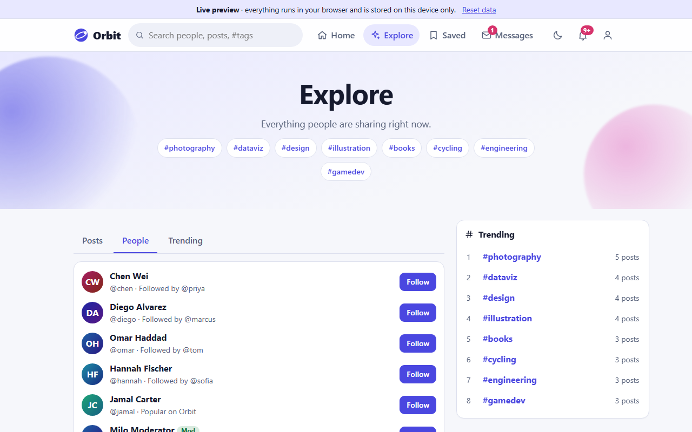
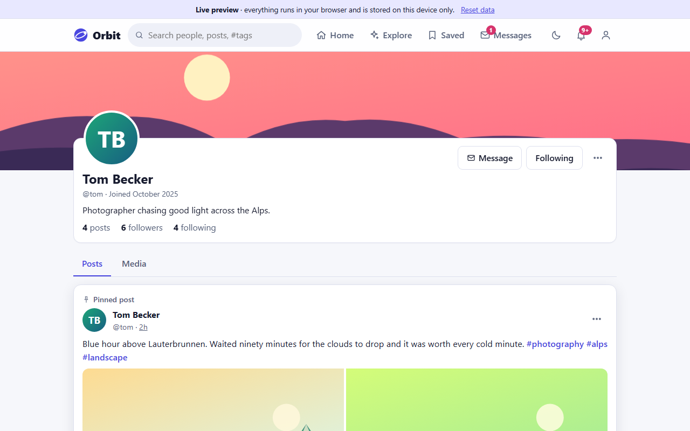
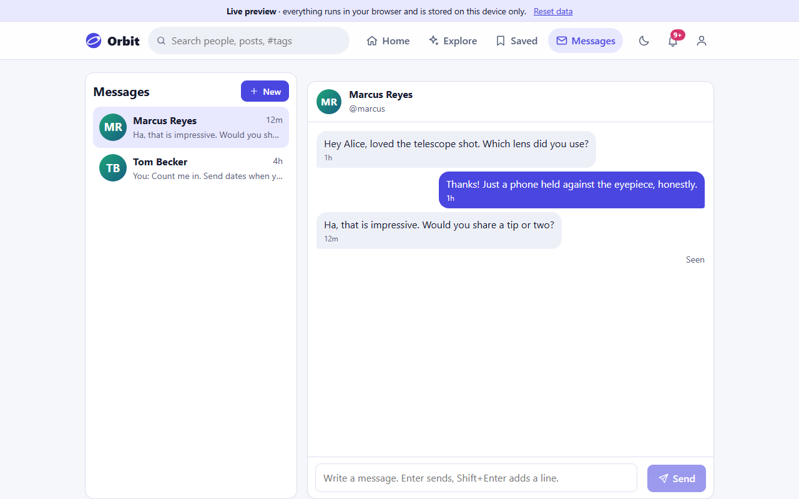
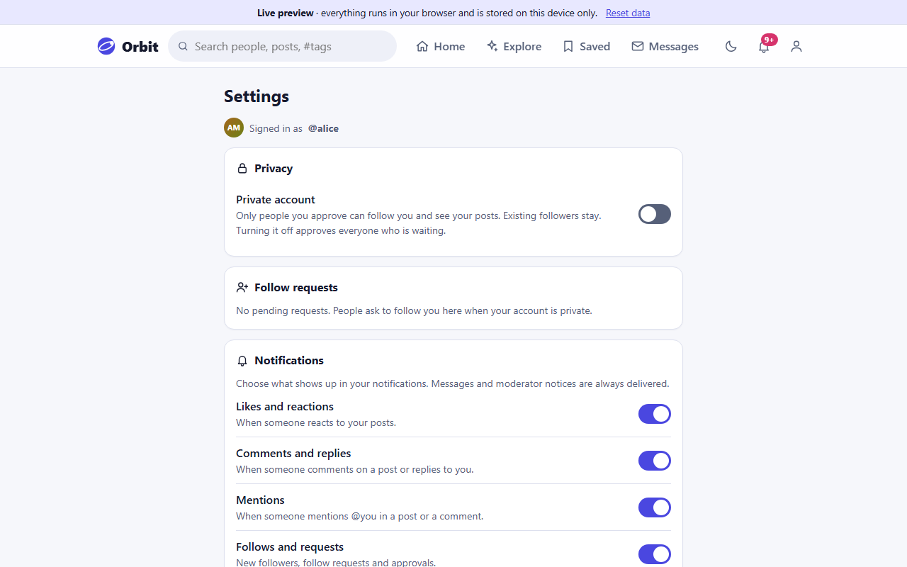
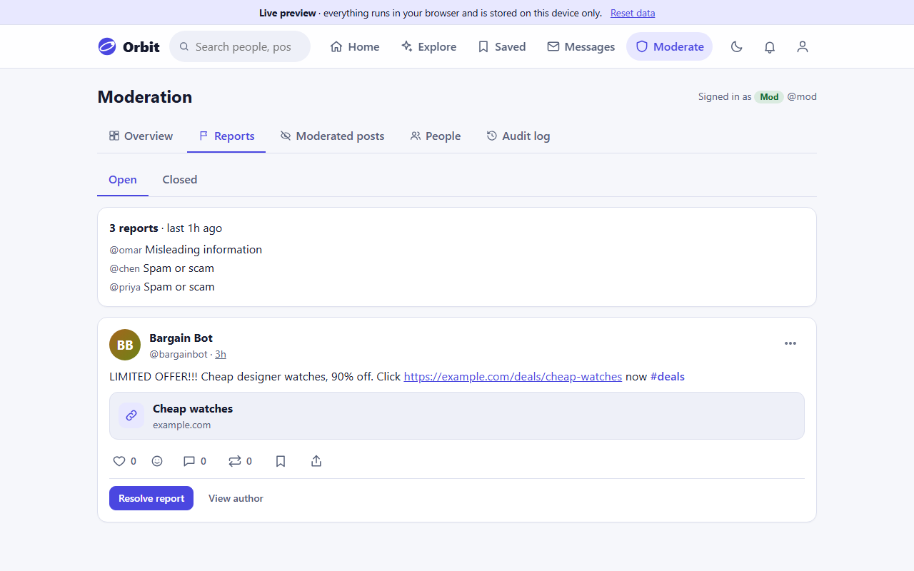
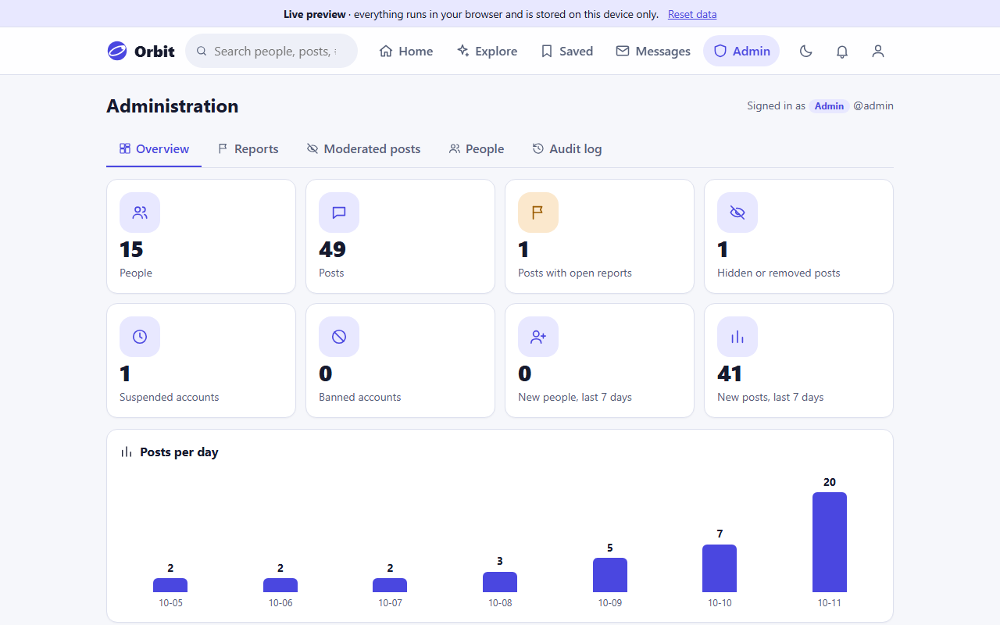
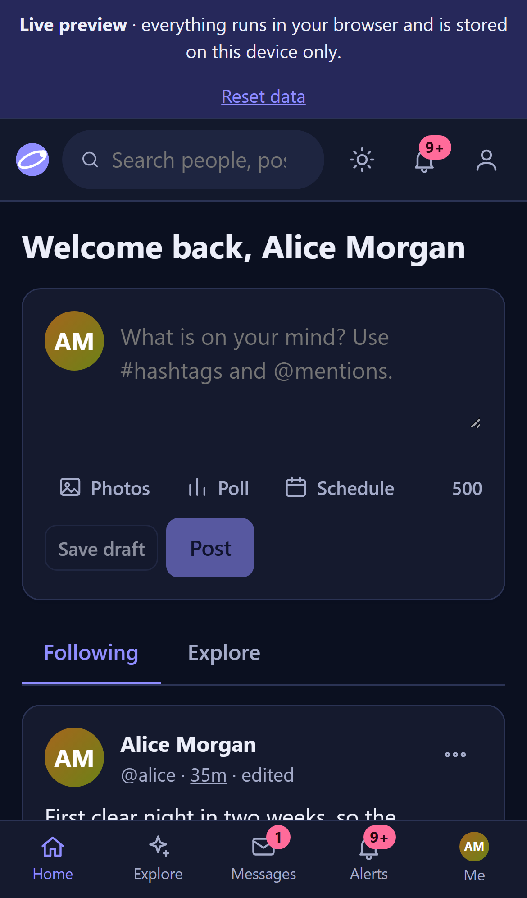
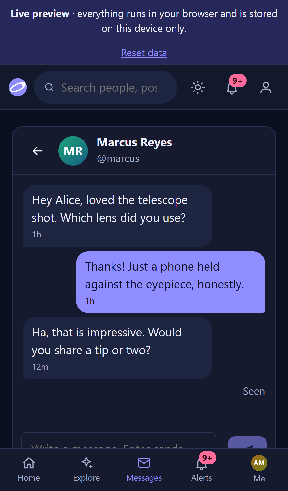

# Orbit - Social Media Platform

A social network with profiles, following, hashtags and mentions, threaded comments, polls, reactions, reposts, direct messages, private accounts, roles with a moderation toolkit, notifications and search.

**Live preview (browser only, no server):** https://shishir19999.github.io/Social-Media-Platfrom/

**Stack:** React 19 + Vite 8 (`Frontend/`), Express 5 + Mongoose 9 + Multer + JWT + bcryptjs + Socket.IO (`Backend/`), MongoDB. Node.js 24 LTS.



| | |
|---|---|
|  |  |
|  |  |
|  |  |
|  |  |

More: [landing page](docs/screenshots/landing.png), [people table for admins](docs/screenshots/admin-people.png).

## Features

**Posting**
- Text posts up to 500 characters with up to 6 images (pick, drag and drop or paste) and a lightbox
- **Polls** (2 to 4 options, 1 hour to 7 days, one vote each, live results), **link cards** for URLs (built locally, no request to the other site)
- **Reposts and quote posts**, five **reactions** (like, haha, wow, sad, applause) with a hover or tap picker
- **Edit with history** (every earlier version is kept and can be viewed), delete, **pin a post** to your profile
- **Drafts and scheduled posts**: save for later or schedule up to 90 days ahead; scheduled posts publish themselves (a 30 second job on the server)
- **@mention autocomplete** while typing, clickable `#hashtags` and `@mentions`

**People and privacy**
- Profiles with avatar, cover, bio, pinned post, Posts / Media / Drafts tabs, followers and following lists
- Follow, **private accounts with follow requests** (approve or decline in Settings), **block and mute**
- **Suggested follows** ("Followed by @x") and a People tab on Explore
- **Notification settings** (likes and reactions, comments, mentions, follows, reposts)

**Conversations**
- Threaded comments with replies and likes
- **Direct messages**, real time: Socket.IO against the API, and a `BroadcastChannel` in the Live preview so two tabs talk to each other. Typing hints, unread badges, read receipts

**Discovery**
- Following and Explore feeds with infinite scroll, trending hashtags, tag pages, saved posts
- Search with People / Posts / Hashtags tabs

**Moderation and administration** (see roles below)
- Reports queue (grouped by post, with reasons), hide, remove and restore posts with a note the author sees
- Suspend (1, 7 or 30 days, lapses by itself) and ban accounts, role management, statistics, **audit log** of every staff action

**Experience**
- Light / dark theme (follows the system, remembered), responsive from 320px, skeleton / empty / error states with retry, optimistic updates (reactions, bookmarks, follows, reposts), toasts and confirm dialogs
- Accessibility: keyboard navigation (menus, tabs, dialogs with focus trap, autocomplete listbox), labelled landmarks, live regions; axe-core reports no violations on the pages checked (see Tests)
- Landing and Explore headers and the profile cover use a subtle parallax and scroll-reveal (transform / opacity only, `IntersectionObserver` + `requestAnimationFrame`, no libraries). It is switched off for `prefers-reduced-motion`, small screens (under 720px), data-saver and low-power devices, and is never applied inside the post feed.

## Roles

| Role | Can do |
|---|---|
| **User** | Everything above for their own account: post, react, message, follow, report posts, block and mute |
| **Moderator** | All of the above, plus: open the **reports queue**, dismiss / hide / remove posts and restore them, delete any comment, **suspend** regular users (restore them again), read the audit log and statistics |
| **Admin** | All of the above, plus: **ban** accounts (signs them out everywhere), **change roles**, see emails in the people table |

Rules enforced on the server (and mirrored in the Live preview): staff cannot act on themselves or on an equal or higher role; moderators cannot moderate an administrator's posts; a suspended account can read but not write until the suspension ends; banned accounts cannot log in and their tokens stop working; every moderation action is recorded in the audit log.

Give someone a role: `cd Backend && npm run set-role -- <username> <user|moderator|admin>`. `npm run seed` creates `admin` (administrator), `mod` (moderator), `user` and `alice` plus about 20 more accounts.

## Run the full stack (real mode)
```bash
# Backend (needs MongoDB, default mongodb://localhost:27017)
cd Backend
cp .env.example .env     # set JWT_SECRET (required)
npm install
npm start                # or: npm run dev

# Frontend
cd Frontend
cp .env.example .env     # VITE_API_URL=http://localhost:5000
npm install
npm run dev
```
Optional seed data: `npm run seed` in `Backend` (idempotent) creates users with password `Password123!` (local sample data only) and about 100 posts. Existing databases keep working: posts from before scheduling get a visibility time on the next start, accounts without a role count as users.

## Run the browser-only Live preview
The Live preview swaps the server layer for an in-browser backend with the same interface and the same rules (`Frontend/src/lib/rules.js` is generated from `Backend/lib/rules.js` and a test fails if they drift). Seeded users, posts, polls, messages and reports live in `localStorage`; uploaded images are downsized and stored as data URLs; no network requests are made. The page shows a "Live preview" banner with a **Reset data** button.
```bash
cd Frontend
npm run dev:demo         # dev server with the in-browser backend
npm run build:pages      # static build for GitHub Pages -> Frontend/dist (base /Social-Media-Platfrom/, hash routing)
npm run preview:pages    # preview the Pages build
```
Sample logins (shown on the login page, password `Password123!`): `alice` (follows people, has notifications, drafts, a scheduled post and an unread message), `marcus`, `mod` (moderator) and `admin` (administrator). You can also register your own account.

**Chat between two people:** the data is shared by all tabs of the browser while each tab keeps its own sign-in. Open the page in two tabs, sign in as `alice` in one and `marcus` in the other and send messages: they arrive live in the other tab. Closing a tab signs it out.

## Environment variables
- Backend: `JWT_SECRET` (**required**), `PORT` (default 5000), `MONGODB_URI` (default `mongodb://localhost:27017/socialMediaDB`), `CORS_ORIGIN` (also used for Socket.IO), `HOST`, `UPLOADS_DIR`.
- Frontend: `VITE_API_URL` (default `http://localhost:5000`, also the Socket.IO address), `VITE_DEMO=true` to use the in-browser backend.

## API
Protected routes need `Authorization: Bearer <token>`. Lists are paginated (`page`, `limit`). Errors are `{ "error": "message" }`.

| Method | Path | Description |
|---|---|---|
| POST | `/api/auth/register`, `/login`, `/logout` | Accounts (`logout` revokes the user's tokens; banned accounts get 403) |
| GET | `/api/auth/me` | Current user (with `role`) |
| GET | `/api/feed?scope=following\|explore&tag=&author=&saved=1&media=1` | Feed (honours privacy, blocks, mutes, drafts, moderation; the author's pinned post comes first) |
| POST | `/api/posts` | Create (multipart or JSON: `content`, `images[]`, `poll`, `quoteOf`, `status=published\|draft\|scheduled`, `scheduleAt`) |
| GET / PUT / DELETE | `/api/posts/:id` | Read, edit (keeps history), delete |
| GET | `/api/posts/mine?status=draft\|scheduled`, `/api/posts/:id/history` | Own drafts and scheduled posts, edit history |
| POST | `/api/posts/:id/like`, `/react`, `/vote`, `/repost`, `/pin`, `/bookmark`, `/hide`, `/report`, `/publish` | Per-viewer actions |
| GET / POST / DELETE | `/api/posts/:id/comments`, `.../:cid`, `.../:cid/like` | Comment threads |
| GET / PUT | `/api/users/:username`, `/api/users/me` | Profile, update (avatar / cover uploads) |
| GET | `/api/users/:username/followers`, `/following`, `/api/users/search?q=`, `/api/users/suggestions` | Connections, mention autocomplete, suggestions |
| POST | `/api/users/:username/follow`, `/block`, `/mute` | Toggle follow (or follow request), block, mute |
| GET / PUT | `/api/settings` | Privacy and notification settings |
| GET / POST | `/api/follow-requests`, `/api/follow-requests/:username/accept\|decline` | Follow requests |
| GET | `/api/relations`, `/api/trending`, `/api/search?q=` | Blocked and muted, trends, search |
| GET / POST | `/api/notifications`, `/api/notifications/read` | Notifications |
| GET / POST | `/api/messages/conversations`, `/unread`, `/with/:username`, `/with/:username/read` | Direct messages |
| GET | `/api/mod/stats`, `/reports`, `/posts`, `/users`, `/audit` | Staff: statistics, reports queue, moderated posts, people, audit log |
| POST | `/api/mod/reports/:postId/resolve`, `/api/mod/posts/:id/state`, `/api/mod/users/:id/status` | Staff: resolve a report, hide / remove / restore a post, suspend / ban / restore an account |
| PUT | `/api/mod/users/:id/role` | Admin only: change a role |
| GET | `/uploads/:file` | Uploaded files (git-ignored, `Backend/uploads/`) |

Socket.IO (same port, `auth: { token }`): the server emits `message:new`, `message:read`, `typing` and `notification:new` to the people concerned.

Uploads accept JPG, PNG and WebP; the type is verified from the file content, not only the mimetype.

## Deploy with Docker

Files: `Backend/Dockerfile`, `Frontend/Dockerfile` (Vite build served by nginx, SPA fallback in `Frontend/nginx.conf`), `.dockerignore` in both folders and `docker-compose.yml` here (mongo + backend + frontend).

```bash
cp .env.example .env      # optional: set JWT_SECRET
docker compose up --build -d
```

- Frontend: http://localhost:8081 (`FRONTEND_PORT`), API: http://localhost:5000 (`BACKEND_PORT`). MongoDB is only reachable inside the compose network and its data lives in the `mongo-data` volume.
- `VITE_API_URL` is baked into the frontend bundle at build time and must be the address the **browser** uses to reach the backend (for a server: `http://<server-ip-or-domain>:5000`); rebuild with `docker compose build frontend` after changing it.
- `CORS_ORIGIN` must contain the origin the browser loads the frontend from (default `http://localhost:8081`); for a server use e.g. `http://<server-ip>:8081`.
- Seed sample data: `docker compose exec backend npm run seed` fails in the production image because the seed uses a dev dependency (`@faker-js/faker`); run the seed from your machine instead: `cd Backend && MONGODB_URL=mongodb://127.0.0.1:27017/socialMediaDB npm run seed` after temporarily publishing mongo (add `ports: ["27017:27017"]` to the `mongo` service).
- Uploaded files are stored in the `uploads` volume (`UPLOADS_DIR=/data/uploads`).
- Direct messages use Socket.IO on the API port (5000), so the browser must be able to reach `VITE_API_URL` over WebSocket as well; `CORS_ORIGIN` applies to it too.

> Note: these Docker files were written and reviewed but not built or run in the authoring environment (Docker engine was off).

## Open the app from a phone on the same Wi-Fi

1. Find the PC's LAN IP (`ipconfig` on Windows, look for the IPv4 address, e.g. `192.168.1.79`).
2. Start the backend bound to all interfaces (the default `HOST=0.0.0.0`) with the phone's origin allowed, and Vite with `--host`:
   ```bash
   # Backend
   CORS_ORIGIN=http://localhost:5173,http://192.168.1.79:5173 npm start
   # Frontend: the API URL must use the LAN IP, not localhost
   VITE_API_URL=http://192.168.1.79:5000 npm run dev -- --host 0.0.0.0 --port 5173
   ```
   (PowerShell: `$env:CORS_ORIGIN="..."; npm start`.)
3. Allow the two ports through Windows Firewall (first run usually prompts; otherwise add an inbound rule for TCP 5000 and 5173, "Private" network only).
4. On the phone (same network) open `http://192.168.1.79:5173`.

Without `CORS_ORIGIN` set the API accepts any origin. If the phone shows the page but API calls fail, `VITE_API_URL` still points at `localhost` or the origin is missing from `CORS_ORIGIN`.

## Tests

```bash
cd Backend  && npm test          # 30 tests: node:test + supertest (+ socket.io-client for live messages)
cd Frontend && npm test          # 25 tests: vitest (the Live preview backend, shared rules, helpers)
cd Frontend && npm run lint && npm run build && npm run build:pages
```
The backend tests run against throwaway local databases (`sm_test_*`) that are dropped afterwards (set `TEST_MONGO_URI` to change the server, default `mongodb://127.0.0.1:27017`; `TEST_PORT` for the Socket.IO test, default 5101). Both suites cover roles and moderation, polls, reactions, reposts, drafts and scheduling, edit history, private accounts, blocking, notification settings and direct messages, so the real API and the Live preview behave the same. `Frontend/src/lib/rules.test.js` fails if `Frontend/src/lib/rules.js` drifts from `Backend/lib/rules.js` (regenerate with `cd Backend && npm run sync-rules`).

Browser checks run with Playwright and axe-core against the Live preview build (all four sample roles, desktop and phone, light and dark) and against a real API run (image upload, polls, live messages over Socket.IO, moderation); they found no console errors and no axe violations.

## Logout, uploads
- `POST /api/auth/logout` (Bearer) bumps `tokenVersion`, revoking all earlier tokens of that user; tokens of deleted users are rejected too. The Logout button calls it.
- Allowed uploads are JPG, PNG, WebP and PDF. The type is verified from the file content (magic numbers), not only the browser-supplied mimetype (some browsers send `application/octet-stream` for `.webp`). `UPLOADS_DIR` overrides the upload folder (default `Backend/uploads`).
